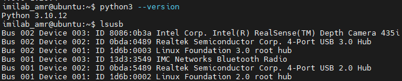

# Jetson Orin Nano + RealSense D435i：單機工件尺寸量測

## 修改目標

本程式改寫自提供的 `subscriber_depth.py`（檔案註解寫 `subscriber_ai.py`），改成 **Jetson Orin Nano 以 USB 直接連接 Intel RealSense D435i**。相機影像不再由樹莓派透過 LCM 傳入。

- **保留：** 使用彩色＋深度資料進行工件量測的核心目的。
- **移除：** `lcm`、`exlcm`、`IMAGE_PAIR` 訂閱、`SYSTEM_STATUS`、CNC／Robot 命令及各類狀態機、`threading`。
- **移除：** 原程式 `W: 120.3` 等固定假數值。
- **不再依賴：** 原始程式引用、但本次未提供的 `workpiece_processor.py`。改由本檔自行完成桌面平面校正、3D 工件分割和尺寸估算。
- **輸出：** 即時終端機顯示長、寬、高（mm），Jetson 桌面視窗疊圖，以及按 `S` 保存 PNG／CSV。
- **逐段／主要執行行中文註解：** `jetson_d435i_measure.py` 已附。

## 硬體擺放要求（非常重要）

1. 以 **USB 3.x** 將 D435i 直接接到 Jetson Orin Nano，儘量不要經過供電不足的 USB Hub。
2. 牢固固定相機，**俯拍水平、平坦、盡可能無反光的桌面**。
3. 將要測量的工件放在桌面上，**整個工件不可超出 ROI**，且頂面與部分輪廓需被相機看見。
4. **校正一定要空桌面**，並在校正後 **不要搬動相機或桌面**。若移動就重新校正。
5. 相機與桌面距離應在 D435i 合適的深度感測範圍內，保持光線穩定。
6. 這是一種 3D 點雲可見外形量測：長、寬為物件**可見深度點投影到桌面後的旋轉外接矩形**；高為點雲到桌面的第 95 百分位高度，**不是精度認證的物理量測器**。側壁遮擋、鏡面、黑色吸光材質、細小零件、手部入鏡及反光會造成誤差。若物件底面比頂面大且側壁不可見，估算的長寬可能偏小。

## 1. 確認 Jetson 系統與 Python

```bash
cat /etc/nv_tegra_release
uname -m
python3 --version
lsusb
```


`uname -m` 一般應回傳 `aarch64`。Jetson 的 RealSense SDK 安裝與 JetPack/L4T 版本相依，**請先確認版本再挑選官方相容安裝方法**。

參考 RealSense 官方 Jetson 指南：
https://github.com/realsenseai/librealsense/blob/master/doc/installation_jetson.md

## 2. 安裝 OpenCV 與 NumPy

對 Jetson 原生 Ubuntu 最保守的方式是先使用系統套件，減少 pip 升級 NumPy 造成的 ABI 相容問題：

```bash
sudo apt update
sudo apt install -y python3-pip python3-numpy python3-opencv
python3 -c 'import cv2, numpy; print(cv2.__version__, numpy.__version__)'
```

如果你是自行建立的 `venv`，要確認該環境可以存取上述依賴，或在 venv 內安裝與 JetPack 相容的版本；不要未確認相容性就批次升級系統的 NumPy / OpenCV。

## 3. 安裝 RealSense SDK 與 Python bindings

**`pyrealsense2` 不是保證能用 `pip install` 在所有 Jetson ARM64 / JetPack 組合中安裝的套件。** 先試檢查是否已存在：

```bash
python3 -c 'import pyrealsense2 as rs; print("pyrealsense2 OK", rs.__file__)'
```

若已成功匯入，可直接跳到執行。若尚未安裝：

- 先按 RealSense 官方 [Jetson 安裝指南](https://github.com/realsenseai/librealsense/blob/master/doc/installation_jetson.md) 安裝相容的 librealsense SDK（或自行編譯）。
- 如果你的 JetPack / SDK 版本提供相容 Python wheel，才使用 `python3 -m pip install pyrealsense2`。
- 若需要從原始碼編譯，**要啟用 `-DBUILD_PYTHON_BINDINGS=true`** 並讓 bindings 安裝到你實際使用的 Python；只裝 `librealsense2-dev` 不代表 Python 一定能 `import pyrealsense2`。
- JetPack 版本或 kernel 若不相容，請依官方文件在原生 kernel backend 與 `RSUSB` backend 間選擇，不要直接套用其他 JetPack 版本的 kernel patch。

在 Linux 桌面上若已有 SDK 工具，先確認相機：

```bash
/usr/local/bin/rs-enumerate-devices
/usr/local/bin/realsense-viewer
```

若 `rs-enumerate-devices` 連 D435i 都看不到，**先處理 USB、相機驅動/權限，再執行本程式**。

## 4. GUI 版本：直接執行

```bash
cd Jetson_D435i_單機工件尺寸量測
python3 jetson_d435i_measure.py
```

- `R`：用滑鼠框選**只有平坦桌面**的 ROI（按 Enter 完成）。
- **清空 ROI 內的桌面**，再按 `C`：收集多張深度影格擬合桌面平面。
- `C` 顯示成功後，才將工件放上桌面，畫面中的綠框標示工件尺寸。
- 終端機定時輸出 `長=... mm / 寬=... mm / 高=... mm`。
- `S`：儲存 `measurement_results/measurements.csv` 和附框 PNG。
- `Q` 或 `Esc`：停止。

**不想用預設 ROI**，可直接在啟動時給座標：

```bash
python3 jetson_d435i_measure.py --roi 80,60,480,360
```

上述數字只是 ROI 示例，**不是工件尺寸或相機校正值**；請依你的桌面畫面調整。

## 5. 只有 SSH 終端機、沒有顯示器時

```bash
python3 jetson_d435i_measure.py --no-window --roi 80,60,480,360
```

程式會先停下來等你確認「桌面已清空」並按 Enter，之後校正並持續輸出尺寸。使用 `Ctrl+C` 結束。**這種模式沒有視窗，不能按 R/C/S**，建議第一次先用 GUI 選好合適的 ROI 座標。

## 6. 干擾／雜訊調整

```bash
python3 jetson_d435i_measure.py \
  --min-height-mm 15 \
  --max-height-mm 250 \
  --plane-tolerance-mm 4 \
  --min-area-px 1000 \
  --measure-every 3 \
  --print-every 2
```

這些都是**可調式量測閾值**，不是固定的工件長寬。

- `--min-height-mm`：最薄的可檢出工件高度；太小會受深度噪聲影響。
- `--max-height-mm`：最高可檢出工件高度；超出不計算。
- `--plane-tolerance-mm`：空桌面點雲的平面擬合允許誤差。
- `--min-area-px`：工件至少要占多少畫素才能被計算。
- `--roi`：務必限制到桌面、避開牆壁與邊緣。
- `--measure-every`：Jetson 處理速度慢時可提高，每 N 影格分析一次。
- `--display-width`：只改視窗大小，不改點雲的計算解析度。

## 7. 結果及使用限制

終端機輸出範例（**示意，不代表已測得的工件數據**）：

```text
[校正完成] 相機到桌面參考點距離：約 ... mm
[量測] 工件#1  長=... mm  寬=... mm  高=... mm  (有效點=...)
```

不管你採用 GUI 或 SSH，都必須先完成空桌面校正；沒有桌面深度幾何便無法可靠把像素長寬轉成 mm。

## 8. 測試與驗證

不接 D435i，也可在開發電腦先測試平面與工件尺寸演算法：

```bash
python3 test_geometry.py -v
```

內建單元測試使用**合成點雲**，測試矩形工件長寬高是否由 3D 資料正確計算。**目前未在實體 Jetson Orin Nano + D435i 上執行實測**。請在正式使用前以游標卡尺量測已知尺寸的工件，從不同位置／高度重複測量，評估誤差與穩定性；若需要工業精度，還需更完整的標定／誤差模型。

## 9. 為什麼沒有 `WorkpieceProcessor`、LCM 與 CNC 狀態機？

原始 `subscriber_depth.py` 沒有包含 `workpiece_processor.py` 的實際辨識與量測演算法，因此不能假設該模組如何辨識材質或形狀。這一版重新設計了**幾何量測流程**，不聲稱保留原先不在附件內的材質分類與形狀分類；當前程式只計算可見工件長寬高，不再命令 CNC、機械手臂。
